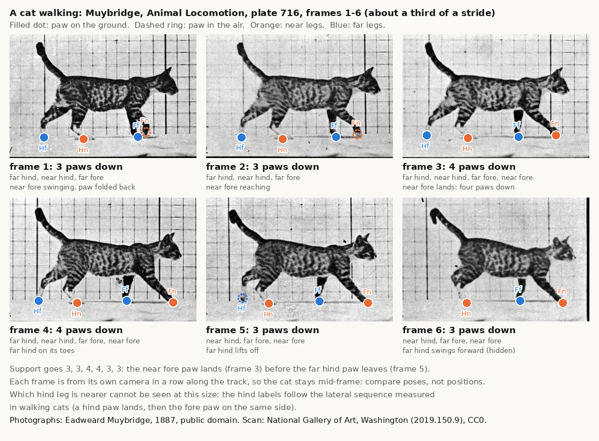
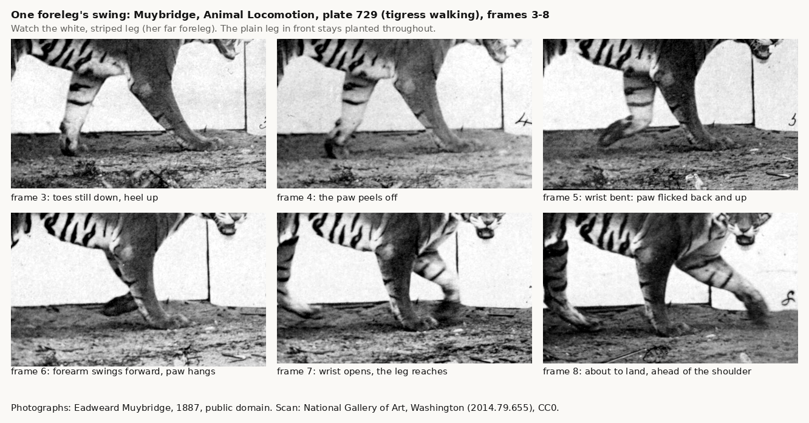
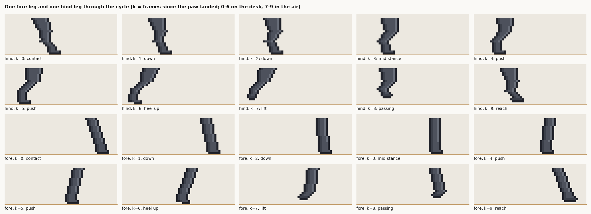
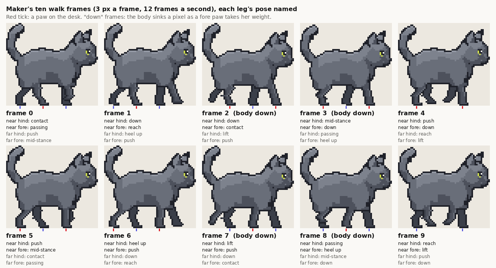
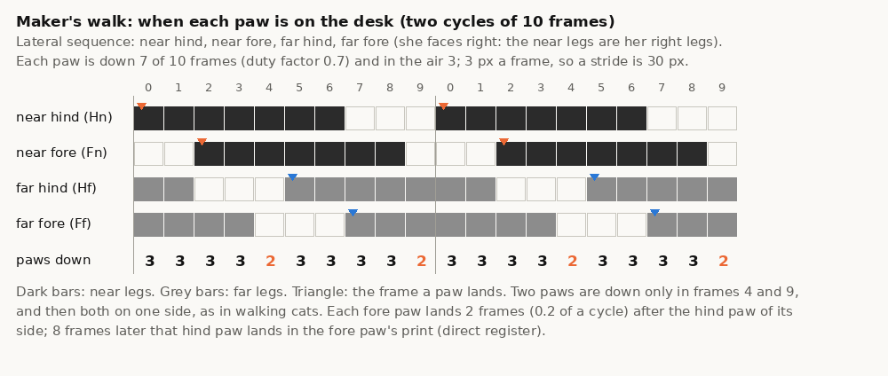
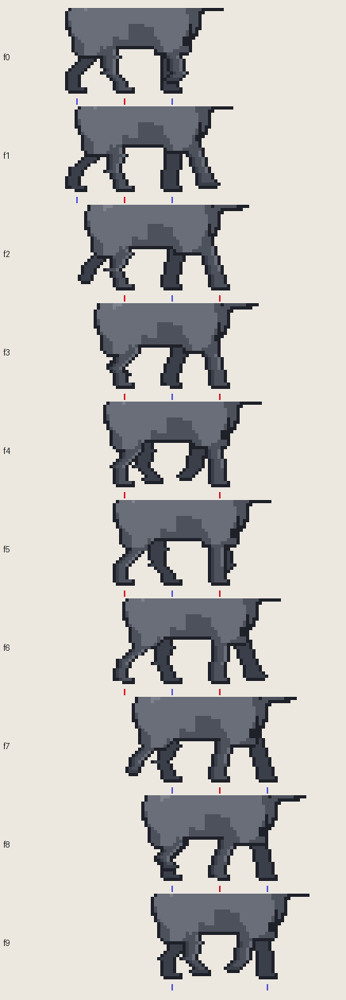

# Animal walk cycles: how a cat walks, and how to draw it

Version 1.0.0 · Created 2026-10-03

Cole rejected two walks for Maker: a generated four-frame sheet (only one hind leg moved) and a code rig (long tube
legs, and, as it turned out, its legs landed in a primate's order, not a cat's). His verdict on the second: "completely
wrong". This file gathers what a walk is, how a cat really walks, how animators break a walk into frames, and the exact
recipe behind Maker's current walk (`tools/desk/walk_rig.py` 2.0), so the next walk (or the next animal) starts from
facts. Pictures are in `walk-refs/`; `make_walk_refs.py` rebuilds them.

Contents: [the terms](#1-the-terms) · [how a cat walks](#2-how-a-cat-walks-the-numbers) ·
[the legs](#3-the-legs-of-a-digitigrade-animal) · [body, head, tail](#4-body-head-and-tail) ·
[how animators frame a walk](#5-how-animators-break-a-walk-into-frames) · [the recipe](#6-the-recipe-makers-walk) ·
[checking](#7-how-to-check-a-walk) · [what was tried](#8-what-was-tried-before) · [sources](#9-sources) ·
[image credits](#image-credits)

## 1. The terms

| Term | Meaning |
| --- | --- |
| cycle, stride | one full repeat of the gait, from a paw landing to the same paw landing again; the stride is the distance travelled in it |
| stance, swing | the part of the cycle a paw is on the ground, and the part it is in the air |
| duty factor | stance as a share of the cycle. Over 0.5 is a walk (some paw is always down), under 0.5 a run |
| footfall sequence | the order the four paws land. **Lateral sequence**: a hind paw, then the fore paw on the same side, then the other hind, the other fore. **Diagonal sequence**: a hind paw, then the fore paw on the other side (primates walk like this) |
| homolateral lag | how long after a hind paw lands the fore paw on its side lands, as a share of the cycle. Under 0.25 the two paws of one side move almost together (lateral couplets); 0.25 exactly spaces all four footfalls evenly (a singlefoot); 0.25 to 0.5 pairs the diagonal paws (diagonal couplets). Hildebrand's "diagonality" is the same number in percent |
| support pattern | how many paws are down at each moment, and which |
| digitigrade | standing on the toes, with the wrist and the heel (hock) off the ground, as cats and dogs do |
| direct register | each hind paw lands in the print the fore paw on its side has just left |

## 2. How a cat walks (the numbers)

- **Lateral sequence, always.** In treadmill studies of cats walking at 0.3 to 1.0 m/s, every cycle went right hind,
  right fore, left hind, left fore (Frigon et al. 2014). Seen from the side: **near hind, near fore, far hind, far fore**.
  Most mammals walk in lateral sequence; some felids with lateral couplets (Cartmill et al. 2002, after Hildebrand).
- **The fore paw lands a quarter to a sixth of a cycle after the hind paw on its side.** Frigon et al. found the
  homolateral coupling near 90° (0.25 of a cycle) at 0.3 to 0.4 m/s and close to 60° (0.17) at faster walks.
- **Duty factor about 0.7 to 0.8 when she strolls.** The swing hardly changes with speed (about 0.2 to 0.3 s); the
  stance is what shortens as she speeds up. At 0.3 m/s the hind paw stayed down 0.70 to 1.17 s and swung for 0.20 to
  0.30 s; at 0.5 m/s, down 0.58 to 0.63 s, swinging 0.20 to 0.27 s (Frigon et al. 2014, after Goslow et al. 1973). So
  a cat strolling at 0.3 to 0.5 m/s takes 0.8 to 1.4 s a cycle.
- **Two, three or four paws down; never fewer than two.** From 0.4 to 0.7 m/s the paws down went 3-4-3-2-3-4-3-2 per
  cycle, at 0.3 m/s mostly 3 and 4, and the two-paw moments were **both paws of one side** (homolateral double
  support); diagonal pairs appear only at the fastest walks.
- **Direct register.** Felids walk leaving direct-register or overstep tracks: the hind paw lands on (or just ahead
  of) the fore paw's print (National Park Service 2021). This gives a rule for drawing: the distance between the hip
  and the shoulder equals (1 - homolateral lag) x stride, so each hind paw lands where the fore paw was.
- **The order of events in one cycle**, near hind landing first, with the lag at 0.2 and duty factor 0.7: near hind
  lands, near fore lands, far hind lifts, far fore lifts, far hind lands, near hind lifts... Each paw that lands is
  followed, a little later, by the lift of the hind paw on the other side.



Muybridge photographed a cat walking (plate 716, first row; the rest of the plate is the change to a gallop). The six
frames span about a third of a stride: the near fore paw swings forward and lands (frame 3), there are four paws down for
two frames, then the far hind paw, which has been on its toes, lifts off (frame 5). Each frame is from its own camera in
a row along the track, so compare the poses, not the cat's place on the floor. The photographs are small: which hind leg
is nearer cannot be seen, and the labels follow the measured lateral sequence. The foreleg in front, with the stripes, is
plainly the near one; the dark one behind it is the far one.

## 3. The legs of a digitigrade animal

**Fore leg.** The shoulder blade lies flat on the ribs and pivots high on the back, so the whole foreleg swings from
near the top of the chest; the elbow sits tucked behind it at the bottom of the chest. Below it the forearm is a
straight column, the wrist is just above the paw, and the paw is the toes.

- on the ground: the leg is a straight strut that turns from leaning forward (as the paw lands, ahead of the shoulder)
  through upright to leaning back. The paw stays flat and still.
- leaving: the heel of the paw lifts first, then the paw peels off, toes last.
- in the air: the wrist bends, so the paw **flicks back and up** with its sole facing backward; the forearm swings
  forward with the paw hanging from it; then the wrist opens, the leg reaches, and the paw lands flat.



The tigress (plate 729) shows the foreleg's swing large and clearly: frames 3 to 8 of her far foreleg go heel up, peel
off, flick back, swing forward with the paw hanging, reach, land. A domestic cat moves the same way.

**Hind leg.** The hip is high in the haunch, the knee (stifle) at the front of the thigh near the belly, the **hock (the
heel) high off the ground and pointing backward**, then a long slim foot (the metatarsus) down to the toes.

- landing: the leg reaches forward, the foot sloping forward from the hock to the paw.
- taking the weight ("down"): the knee and the hock give a little.
- upright under the hip, then pushing: the leg slants back, **the shin slanting back more than the foot**, the heel
  rises, the toes leave last.
- in the air: the hock folds and the foot hangs toes down behind; it passes under the belly folded, then opens forward
  to land.
- **Rule: the hock's angle always points backward.** If the shin stands upright while the foot slants back, the joint
  bends the wrong way, like a person's knee kicking back. The knee points forward, the hock backward, in every frame.

**Each leg's key poses**, in animators' terms: contact, down, passing (mid-stance), push (up), heel off; then in the air
lift, passing, reach.



## 4. Body, head and tail

- **Hips and shoulders rise and fall, out of step.** Each end of the body vaults over its planted legs: the shoulders are
  highest when one foreleg alone holds them up, upright under them, and lowest just after a fore paw lands with both
  forelegs spread; the hips the same with the hind legs. With the lateral sequence the two ends peak at different
  moments, so the back rocks gently. Animators give the hips more bounce than the chest (AnimSchool 2025).
- **The head stays steady.** A stalking animal keeps its eyes level; let the head ride with the shoulders and move it
  less, never more.
- **The spine** bends a little from side to side in life; at sprite size keep the body one piece.
- **The tail follows** (overlapping action): it moves after the body moves, never with it. A raised tail sways gently;
  its tip lags.

## 5. How animators break a walk into frames

- **Contact, down, passing, up.** Richard Williams (*The Animator's Survival Kit*, 2001) builds a walk from these four
  positions per step: the foot lands (contact), the body sinks onto it (down), the free leg passes the standing one
  (passing), the body is pushed up (up). Draw the extremes first, then the breakdowns, then the in-betweens.
- **A four-legged animal is two walkers, one behind the other, out of step.** The back pair leads (a hind paw lands,
  then the fore paw on its side), the front pair follows; their bobs alternate (AnimSchool 2025). Williams' book has
  four-legged walks too (its horse walk is a common reference); Preston Blair's *Cartoon Animation* (1994) is the other classic on
  walks. (Both books are described here in words; they are copyrighted.)
- **Plant the feet.** In a cycle drawn on the spot, a planted foot must move back by exactly the distance the animal
  travels per frame, or it skates. This scene goes further: it picks the frame from her position (`floor(x / 3) mod N`),
  so if every planted paw moves back exactly 3 px a frame, it is nailed to the desk whatever the frame rate.
- **Spacing in the swing.** A swinging paw starts slowly, is fastest in mid-swing and slows before it lands. Over the
  desk, Maker's swinging paws move about 5, 11, 10, 4 px (fore) and 4, 11, 9, 6 px (hind) between frames: 30 px, one
  stride, in four steps.
- **Timing.** The swing of a cat is about a quarter of a second at any walking speed; it is the stance that stretches
  for a slow walk. At the scene's 12 frames a second that is 3 frames in the air.
- **Pixel-art craft** (learned on Maker):
  - draw a limb as even-width rows of pixels whose two edges are straight lines from joint to joint; a width that
    changes row by row leaves teeth on the outline
  - outline every limb; near legs in the coat's shade with a light front edge, far legs a step darker and behind the
    body; where a near leg leaves the body, the body's outline opens into the leg
  - a planted paw is one stamp moved by whole pixels; never redraw it per frame
  - move the body only as a whole: raising the front and the back separately leaves a notch in the outline
  - the exporter trims every sprite to its pixels and the scene centres it by its width and stands it on its bottom
    row, so every frame must keep the same leftmost and rightmost columns and have a paw on the bottom row

## 6. The recipe: Maker's walk

Maker faces right (the scene mirrors her to walk left), so we see her right side: the near legs are her right legs.
Her body, head and tail are the `stand` sprite, the pose she kneads in, with its legs cut off below the haunch, belly and
chest; walking and kneading share one body and one bounding box (60 x 54), so the switch does not jump.

| | Maker | why |
| --- | --- | --- |
| frames a cycle | 10 (`walk0`..`walk9`, each with a `Blink` twin) | stride / speed |
| speed | 3 px a frame, 12 frames a second (the scene's) | unchanged |
| stride | 30 px, 0.83 s a cycle | her legs are short: 12 px below the body, the hip and shoulder about 22 px above the desk |
| duty factor | 0.7: 7 frames down, 3 in the air | a cat strolling |
| stance stroke | 18 px (6 steps of 3): the legs lean about 22° either way | wider tips her short legs past 30° |
| footfalls | near hind 0, near fore 2, far hind 5, far fore 7 | lateral sequence, lag 0.2 |
| paws down | 3, except frames 4 and 9: 2, both of one side | as cats |
| pivots | hip at column 15, shoulder at 39: 24 px apart = 0.8 x 30 | each hind paw lands exactly in the fore paw's print |
| landing paw (heel column) | fore 45, hind 21; then 3 px back each frame | the paw's back edge; the stamp is 7 px long |
| swing | lift 2 px up, passing 3 px up, reach 1 px up | a low cat step |
| body | sinks 1 px in frames 2-3 and 7-8 (the two frames after each fore paw lands) | the "down" position |
| tail | its top follows the body's dip a frame late (frames 3-4, 8-9) | overlapping action |

The pose of each leg in its own cycle (k = frames since that paw landed):

| k | on the desk? | fore leg | hind leg |
| --- | --- | --- | --- |
| 0 | yes, lands | straight, leaning forward, paw flat ahead of the shoulder | reaching, foot sloping forward from the hock |
| 1-2 | yes | straight, coming upright ("down": the body sinks) | knee and hock giving, foot less sloped |
| 3 | yes | upright under the shoulder | upright under the hip: shin back, foot forward, heel points back |
| 4-5 | yes | leaning back | slanting back, the shin more than the foot |
| 6 | yes, last | leaning back, heel of the paw up, toes down | heel up, toes down |
| 7 | no | wrist bent, paw flicked back, 2 px up | foot hanging toes down behind, 2 px up |
| 8 | no | forearm swinging forward, paw hanging, 3 px up | hock folded, paw under the hip, 3 px up |
| 9 | no | leg reaching, paw opening, 1 px up | leg opening forward, paw ahead, 1 px up |





**For another animal or size**, the same steps:

1. Measure the visible leg below the body, the pivot height (hip and shoulder to the ground) and the hip-to-shoulder
   distance D.
2. Stance stroke: about 2 x pivot height x tan 20-25°. (Maker: 22 px gives 16 to 20; 18 chosen.)
3. With the scene's speed v px a frame and a duty factor near 0.7: frames down = stroke / v + 1; frames a cycle N =
   frames down / 0.7 (round to whole frames); stride = v x N.
4. Homolateral lag: the value between 0.15 and 0.3 that makes (1 - lag) x stride come out at D. Then the hind paw lands
   in the fore print, and the near fore lifts before the near hind lands behind it (no tangle of paws).
5. Footfalls: near hind 0, near fore lag x N, far hind N / 2, far fore N / 2 + lag x N.
6. Three frames in the air: lift, passing, reach; heights 2, 3, 1 px for a cat this size.
7. Body down 1 px for the two frames after each fore contact; the tail one frame behind.
8. Draw, then check (below). Change the scene's cycle length to N.

## 7. How to check a walk

```bash
python3 tools/desk/walk_check.py /path/to/outdir    # walk-contact.png, walk-strip.png, walk-onion.png, walk.gif, walk-inplace.gif
python3 tools/desk/docs/make_walk_refs.py            # rebuilds the pictures in this folder
```

- **Footfall order.** In the contact sheet, note the frame each paw lands: it must be near hind, near fore, far hind,
  far fore. If it reads near hind, far fore, far hind, near fore, the phase offsets have the wrong sign: that is a
  primate's diagonal walk (the rejected rig had exactly this bug: it added each leg's offset to the phase where it
  should have subtracted it).
- **Paws down.** Two to four in every frame; at a stroll, the two-paw frames are both paws of one side.
- **Planted paws stay put.** In the strip (each row moved on by the travel), a planted paw's tick stays in one column
  for all its frames on the desk. In the onion skin, planted paws pile up into a sharp paw while the rest blurs.
- **Nothing jumps.** Every frame has the same width and leftmost column, and a paw on the bottom row (`walk_check`
  prints the sizes); the body moves only where it is meant to (the 1 px dip).
- **Each leg is a cat's leg.** Forelegs straight on the desk, the paw flicking back as it lifts; in every hind pose the
  hock points backward; no leg leaning past about 30°.
- **Timing.** About 0.25 s in the air, a cycle of 0.8 to 1.2 s; watch the GIF at 12 frames a second and at the scene's
  size, and walk her both ways in the scene.



## 8. What was tried before

- v1.5 of `maker_build.py`: one generated picture of a four-frame cycle, cut into frames. The model drew poses that
  hardly differed; only one hind leg moved.
- v1.6 (`walk_rig.py` 1.0): legs drawn in code as long tubes on a generated body, 12 frames, duty factor 0.6, the body
  dipping twice a cycle. The legs were too long and stiff, and the order came out diagonal (see above).
- 2026-10-03, while making this walk: FLUX.2 klein 4B was given the rig's frames to redraw. Generated from noise it
  draws natural legs but moves them; image-to-image from the frame itself at about 0.8 denoise keeps them in place and
  makes them natural. At 60 px, though, the reduction wipes out that difference, so the legs are drawn by the rig, as
  pixel spans tuned by eye against the photographs.

## 9. Sources

- Frigon A, D'Angelo G, Thibaudier Y, Hurteau MF, Telonio A, Kuczynski V, Dambreville C (2014). Speed-dependent modulation of phase variations on a step-by-step
  basis and its impact on the consistency of interlimb coordination during quadrupedal locomotion in intact adult cats.
  *J Neurophysiol* 111: 1885-1902. https://pmc.ncbi.nlm.nih.gov/articles/PMC4044364/ (footfall sequence, coupling,
  support periods, stance and swing durations)
- Cartmill M, Lemelin P, Schmitt D (2002). Support polygons and symmetrical gaits in mammals. *Zool J Linn Soc* 136:
  401-420 (duty factor and diagonality, lateral and diagonal couplets, which mammals use which)
- Goslow GE, Reinking RM, Stuart DG (1973). The cat step cycle: hind limb joint angles and muscle lengths during
  unrestrained locomotion. *J Morphol* 141: 1-41 (the swing hardly changes with speed)
- National Park Service, Mount Rainier (2021). *Carnivore Tracks*.
  https://www.nps.gov/mora/planyourvisit/upload/Carnivore-Tracks-12-20-21_508.pdf (felids walk in direct register)
- AnimSchool (2025). Animating a quadruped. https://blog.animschool.edu/2025/07/22/animating-a-quadruped/
- Eadweard Muybridge (1887). *Animal Locomotion*, plates 716 (cat walking), 729 (tigress walking); see also 704 (dog
  walking), 721-722 (lion walking), 731 (jaguar walking), 576 (horse walking). Open-access scans: National Gallery of Art
  (https://www.nga.gov, open data on GitHub: NationalGalleryOfArt/opendata) at 4096 px; smaller ones from the Boston
  Public Library on Wikimedia Commons.
- Richard Williams, *The Animator's Survival Kit* (Faber, 2001); Preston Blair, *Cartoon Animation* (Walter Foster,
  1994). Copyrighted; described in words only, nothing reproduced.

## Image credits

| File | What | Credit and licence |
| --- | --- | --- |
| `walk-refs/muybridge-716-cat-walk.png` | plate 716, first row, frames 1-6, cropped, contrast raised, labelled | Eadweard Muybridge, *Animal Locomotion* (1887), public domain. Scan: National Gallery of Art, Washington, accession 2019.150.9, open access (CC0) |
| `walk-refs/muybridge-729-tigress-foreleg.png` | plate 729, frames 3-8, cropped to the forelegs, contrast raised, captioned | Eadweard Muybridge, *Animal Locomotion* (1887), public domain. Scan: National Gallery of Art, Washington, accession 2014.79.655, open access (CC0) |
| `walk-refs/maker-walk-*.png` | Maker's walk frames, legs, gait diagram and travel strip | made from this repo's sprites (Maker's pictures: FLUX.2 klein 4B, Apache 2.0, see `../sources/PROVENANCE.md`); no third-party material |
